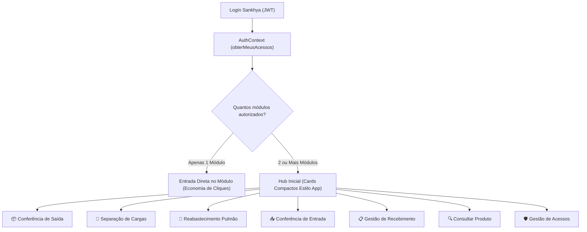
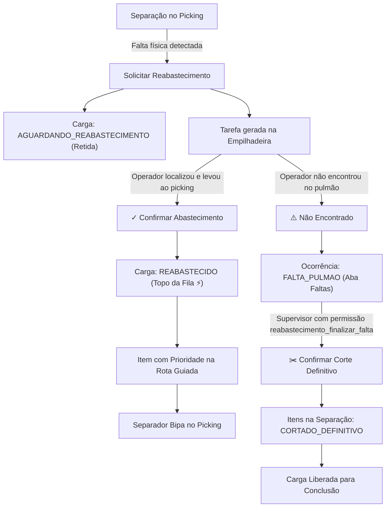

# Arquitetura de Controle de Acessos, Rotinas Granulares e Hub Inicial

Este documento detalha o funcionamento, as regras arquiteturais e o fluxo operacional do sistema de **Gestão de Acessos por Usuário**, **Proteção de Rotinas no BFF/Frontend** e o **Hub Inicial de Módulos** do ConferCheck.

---

## 📌 1. Visão Geral

O ConferCheck adota um modelo de **Permissões Diretas por Usuário com Granularidade de Telas e Rotinas**. Cada usuário cadastrado no ERP Sankhya (identificado por `CODUSU` e `NOMEUSU`) possui um conjunto individualizado de privilégios gravado no banco de dados local (`usuarios_acessos.modulos_json`), garantindo:
1. **Flexibilidade Operacional:** Gestores podem atribuir acessos sob medida para qualquer operador sem a rigidez de papéis estáticos.
2. **Dupla Proteção:** As permissões são validadas tanto na interface (ocultando/desabilitando botões e rotas) quanto no backend BFF (bloqueando requisições HTTP via middleware).
3. **Bloqueio Seguro:** Novas telas e rotinas introduzidas no sistema são inicializadas como inativas para operadores comuns até que o gestor as libere explicitamente.
4. **Proteção Anti-Lockout:** Administradores nativos (`SUP`, `ANTONY`, `ANTONY.B` ou usuários com `gerenciar_acessos`) mantêm acesso total garantido.



---

## 🗂️ 2. Catálogo de Telas e Rotinas

### 2.1. Módulos Principais (Navegação de Topo)
| Identificador | Rota Frontend | Rota Backend BFF | Descrição |
|---|---|---|---|
| `conferencia_saida` | `/conferencias` | `/api/conferencias` | Conferência cega de separação e expedição de pedidos de venda |
| `separacao` | `/separacao` | `/api/separacao` | Separação de pedidos agrupados por Ordem de Carga |
| `reabastecimento` | `/reabastecimento` | `/api/reabastecimento` | Fila de reabastecimento de picking (pulmão -> picking) |
| `conferencia_entrada` | `/recebimento` | `/api/recebimento` | Recepção fiscal, contagem física e bipagem N1/N2/N3 |
| `gestao_recebimento` | `/recebimento/gestao` | `/api/recebimento` | Gestão de divergências, desmembramentos, ocorrências e integração ERP |
| `consulta_produtos` | *(Modal Global)* | `/api/produtos` | Consulta rápida de cadastro, estoque disponível e endereços |
| `gerenciar_acessos` | `/configuracoes/acessos` | `/api/acessos` | Painel de administração de privilégios de usuários e parâmetros |

---

### 2.2. Rotinas Granulares Internas

#### 🚚 Separação de Cargas (`separacao`)
- `separacao_iniciar`: Permite iniciar ou continuar a sessão de separação de uma Ordem de Carga.
- `separacao_bipar`: Permite utilizar o leitor de código de barras ou digitação manual para registrar bipes e conferir itens.
- `separacao_finalizar`: Permite concluir a carga separada e disparar a atualização de status no Sankhya.
- `separacao_cortar`: Permite apontar falta física no picking e confirmar corte definitivo de saldos não localizados.

#### 🚜 Reabastecimento de Pulmão (`reabastecimento`)
- `reabastecimento`: Permite visualizar a fila de solicitações e estoque disponível na empresa.
- `reabastecimento_confirmar`: Permite confirmar a movimentação física do pulmão para o picking (`POST /api/reabastecimento/:id/concluir`).
- `reabastecimento_cancelar`: Permite recusar ou cancelar a tarefa informando o motivo operacional (`POST /api/reabastecimento/:id/cancelar`).
- `reabastecimento_finalizar_falta`: Permite finalizar ocorrências de falta física no pulmão e confirmar corte definitivo nos pedidos da carga (`POST /api/reabastecimento/:id/finalizar-falta`).

#### 🔄 Ciclo Integrado: Separação ⟷ Reabastecimento ⟷ Falta de Pulmão


#### 📥 Conferência de Entrada & Gestão de Recebimento
- `conferencia_entrada_n1`: Execução do Nível 1 (Contagem cega de volumes).
- `conferencia_entrada_n2`: Execução do Nível 2 (Contagem com Lote, Validade e Fabricação).
- `conferencia_entrada_n3`: Execução do Nível 3 (Reconferência de desempate).
- `conferencia_entrada_divergente`: Visualização de produtos em divergência (supervisor).
- `conferencia_entrada_conferido`: Visualização de produtos já finalizados (supervisor).
- `gestao_recebimento_aba_divergencias`: Acesso à resolução de divergências fiscais e desmembramentos.
- `gestao_recebimento_aba_envio_sankhya`: Confirmação e envio da nota conferida para o Sankhya ERP.
- `gestao_recebimento_aba_ocorrencias`: Tratamento de sobras, faltas e avarias físicas.
- `gestao_recebimento_backup`: Visualização e download de logs e histórico de conferências.

#### ⚙️ Privilégios Especiais
- `ver_campos_sensiveis`: Revela colunas fiscais sensíveis (preços, quantidades faturadas, etc.) que são omitidas para conferentes comuns.
- `bipar_por_codprod`: Permite bipar itens utilizando o código interno do produto (`CODPROD`) na ausência de código de barras GTIN/EAN.

---

## 🔒 3. Mecanismo de Dupla Proteção

### 3.1. Proteção no Frontend
1. **Guarda de Rotas ([`PrivateRoute.tsx`](file:///frontend/src/presentation/routes/PrivateRoute.tsx)):**
   - Valida se o usuário autenticado possui o `modulo` exigido.
   - **Regra de Segurança contra Loop:** Se o usuário não tiver permissão para a tela acessada, ele é redirecionado para a raiz (`/` ➔ Hub Inicial), e **nunca** para `/login`. O redirecionamento para login ocorre estritamente quando `!isAuthenticated`.
2. **Controle Visual nas Telas:**
   - Botões de ações restritas (ex: *Confirmar Corte*, *Concluir Carga*, *Confirmar Abastecimento*, *Recusar Tarefa*) são desabilitados ou omitidos caso a flag específica seja `false`.
3. **Menu Lateral ([`AppDrawer.tsx`](file:///frontend/src/presentation/components/AppLayout/AppDrawer.tsx)):**
   - Itens de navegação são renderizados condicionalmente com `temPermissao(modulo)`.
   - Adicionado atalho fixo `🏠 Início / Módulos` no topo do menu.

### 3.2. Proteção no Backend (BFF)
1. **Middleware [`createPermissionMiddleware.ts`](file:///backend/src/presentation/http/middlewares/permissionMiddleware.ts):**
   - Extrai `codUsu` e `nomeUsu` da sessão autenticada.
   - Consulta o repositório de permissões (`IPermissoesRepository`).
   - Se o usuário não possuir a flag requerida (e não for admin nativo), rejeita a chamada com **HTTP 403 Forbidden**:
     ```json
     {
       "error": "Acesso negado: seu usuário não possui permissão para acessar os recursos de [reabastecimento_cancelar].",
       "modulo": ["reabastecimento_cancelar"]
     }
     ```
2. **Rotas Protegidas:**
   - [`separacaoRoutes.ts`](file:///backend/src/presentation/http/routes/separacaoRoutes.ts): rotas de ação (`/iniciar`, `/:id/bipar`, `/:id/falta`, `/:id/finalizar`) protegidas individualmente.
   - [`reabastecimentoRoutes.ts`](file:///backend/src/presentation/http/routes/reabastecimentoRoutes.ts): rotas de ação (`/:id/concluir`, `/:id/cancelar`) protegidas individualmente.

---

## 🚀 4. Hub Inicial de Módulos (Experiência do Usuário)

### 4.1. Regra de Redirecionamento Inteligente (`/`)
Ao autenticar ou acessar a raiz do sistema (`/`), o roteador avalia os módulos autorizados:
- **1 Único Módulo:** Usuários operacionais dedicados (ex: conferente exclusivo de saída) são redirecionados automaticamente para a tela correspondente, poupando toques no coletor.
- **2 ou Mais Módulos:** Usuários com múltiplos papéis (ex: Supervisor com gestão + separação + reabastecimento) são direcionados para o **Hub Inicial** ([`HubPage.tsx`](file:///frontend/src/presentation/pages/Hub/HubPage.tsx)).

### 4.2. Design dos Cards Compactos
Projetado especificamente para visualização ágil em coletores de dados (Zebra/Android) e telas de smartphones:
- Card com ícone em caixa colorida temática.
- Rótulo claro e legível com peso semibold.
- Badge indicativo contextual (`Expedição`, `Vendas`, `Pulmão`, `Divergências`, etc.).
- Efeito tátil responsivo ao toque e hover.

---

## 🛠️ 5. Painel de Gestão de Acessos (`/configuracoes/acessos`)

No painel administrativo ([`GestaoAcessos.tsx`](file:///frontend/src/presentation/pages/GestaoAcessos.tsx)), o gestor pode:
1. **Atalhos Rápidos de Perfil no Topo do Drawer:**
   - **`📦 Conferente`:** Ativa Saída, Entrada, Separação de Cargas, N1, N2, N3 e Consulta de Produtos.
   - **`🚜 Empilhadeirista`:** Ativa Reabastecimento de Pulmão (Visualizar fila, Confirmar abastecimento e Recusar tarefa) e Consulta de Produtos.
   - **`📋 Gestor`:** Ativa Gestão de Recebimento completa, Divergências, Desmembramentos, Ocorrências, Separação, Reabastecimento, Níveis e Campos Sensíveis.
   - **`🛡️ Admin`:** Ativa todos os recursos do sistema e gerenciamento de acessos.
   - **`🚫 Bloquear`:** Desativa todos os módulos do usuário.
2. **Sub-painéis Expansíveis:**
   - Ao ligar a chave-mestra de um módulo (ex: *Separação de Cargas* ou *Reabastecimento de Pulmão*), um sub-painel elegante se expande logo abaixo permitindo ligar ou desligar cada rotina individualmente.
3. **Salvamento Instantâneo:**
   - Cada clique no toggle salva a alteração imediatamente no backend e atualiza a sessão caso o usuário alterado seja o próprio operador conectado.

---

## 📜 6. Histórico de Resolução do Loop de Login do Supervisor

### Sintoma Relatado
> *"Estou tentando fazer o login com o usuário supervisor e ele volta para a tela inicial."*

### Causa Técnica
O usuário `SUPERVISOR` possuía as seguintes permissões no banco:
```json
{
  "conferencia_saida": false,
  "conferencia_entrada": false,
  "separacao": true,
  "reabastecimento": true,
  "gestao_recebimento": true,
  "gerenciar_acessos": false
}
```
O método `handleSubmit` em `Login.tsx` avaliava apenas `conferencia_saida`, `conferencia_entrada` e `gerenciar_acessos`, caindo em um fallback fixo:
```ts
navigate('/recebimento'); // Erro: assumia que qualquer outro perfil era conferência de entrada
```
A rota `/recebimento` exigia `conferencia_entrada`. Ao bater no `PrivateRoute`, o usuário não tinha a permissão e o middleware caía na rota de descarte:
```ts
return <Navigate to="/login" replace />; // Erro: deslogava o usuário em vez de levá-lo para suas telas
```

### Correção Aplicada
1. `Login.tsx` agora direciona qualquer login bem-sucedido para a raiz `/`.
2. A rota `/` avalia os acessos ativos via `RotaInicialRedirect`: para usuários com múltiplos módulos como o `SUPERVISOR`, renderiza o **Hub Inicial**.
3. `PrivateRoute.tsx` foi corrigido para que falhas de autorização redirecionem para `/` (Hub), mantendo o usuário autenticado e exibindo suas opções válidas.
