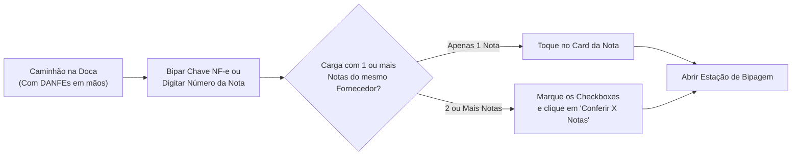
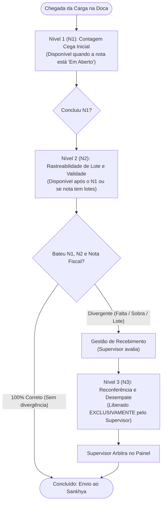
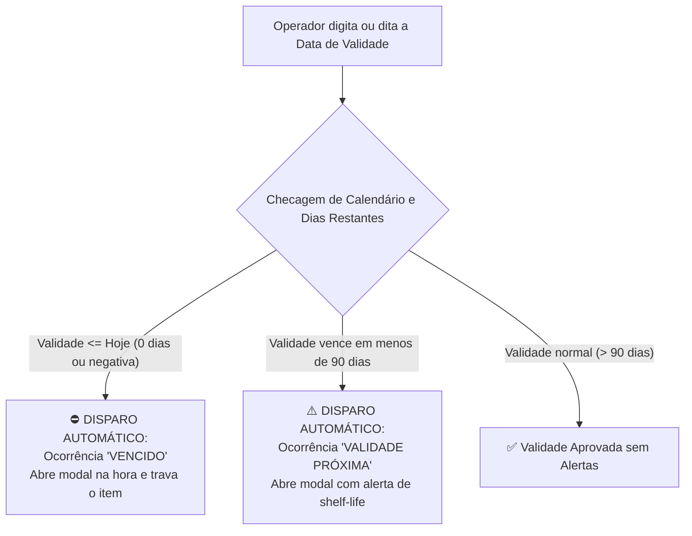
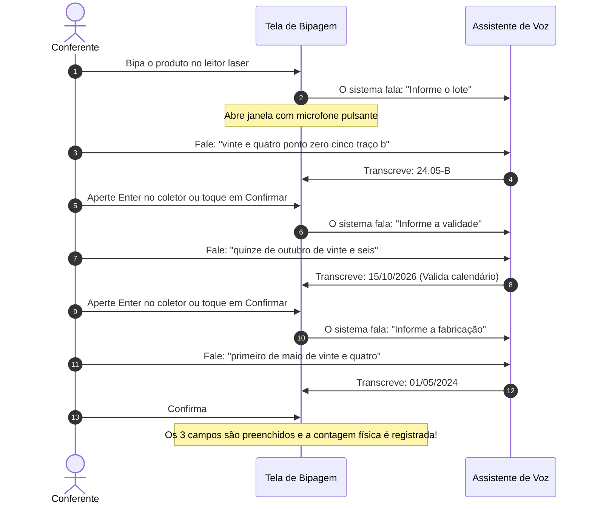
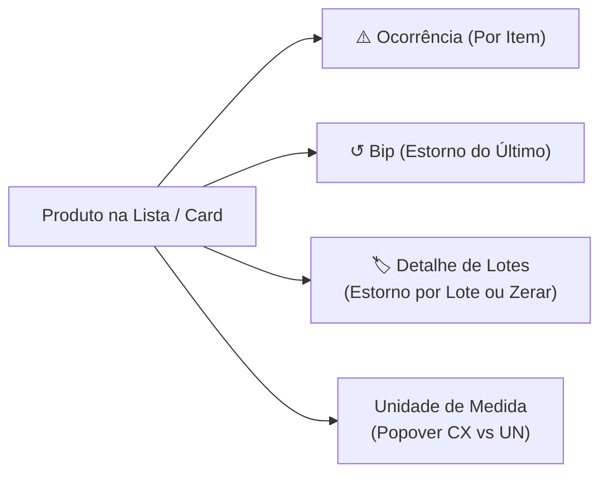

# Guia Prático do Usuário: Conferência de Entrada (Recebimento de Mercadorias)

> **Público-Alvo:** Conferentes de Carga, Operadores de Coletor Móvel, Líderes de Doca e Encarregados de Recebimento.  
> **Finalidade:** Manual operacional definitivo, passo a passo, cobrindo desde a chegada da carga até a finalização da conferência no armazém.

---

## 1. Primeiros Passos: Localizando as Notas Fiscais (`/recebimento`)

Quando o caminhão estaciona na doca para descarregar, você deve localizar a(s) Nota(s) Fiscal(is) no sistema antes de iniciar a contagem física.

### 1.1. Localização Instantânea da Nota Fiscal
No campo de busca no topo da tela, você pode:
* **Bipar a Chave de Acesso da NF-e:** Aponte o leitor laser para o código de barras grande de 44 dígitos impresso no topo do papel da nota fiscal (DANFE). O sistema limpa os espaços e abre a nota na hora.
* **Digitar o Número da Nota:** Digite o número impresso na nota fiscal de compra.
* **Digitar o Nome do Fornecedor:** Escreva o nome da empresa ou razão social.

### 1.2. Prioridade de Descarga por Previsão (`📅 Previsão ↑ / ↓`)
O sistema analisa a data de previsão de entrega combinada com o fornecedor:
* **Card Vermelho / Atrasado:** O caminhão já deveria ter chegado. Dê prioridade imediata para descarregar essa carga.
* **Card Normal / Entrega Hoje:** Carga programada para o dia atual.
* **Botão 📅 Previsão:** Toque nele para inverter a lista entre as notas mais urgentes e as entregas futuras.

### 1.3. Cargas com Várias Notas Juntas (Conferência em Lote)
Se o fornecedor emitiu 2 ou mais notas fiscais para o mesmo caminhão:
1. Marque o quadradinho de seleção ao lado de cada uma das notas que pertencem àquela entrega física.
2. No topo da tela, surgirá um botão azul destacado: **`📦 Conferir {X} Nota(s)`**.
3. Toque nele. O sistema reunirá todos os produtos dessas notas em uma única tela de conferência para você poder descarregar tudo junto.
4. *Observação de Segurança:* Notas já finalizadas e integradas ao estoque não podem ser selecionadas novamente (suas caixinhas ficam desabilitadas).

---

## 2. Os 3 Níveis de Conferência: Quando e Como Cada Um Fica Disponível

Para garantir precisão cirúrgica e evitar erros que possam travar o estoque ou a emissão de notas, o sistema divide a conferência em **3 Níveis Progressivos**:

### 2.1. Nível 1 (N1) — Contagem Física Cega
* **Quando fica disponível:** Imediatamente quando a nota entra no sistema com status **`Em Aberto`**.
* **Quem tem acesso:** Qualquer conferente que possua a permissão `conferencia_entrada_n1`.
* **Qual o objetivo:** Contar o volume físico bruto de caixas e unidades descarregadas do caminhão, **sem se preocupar ainda com lote ou validade**.
* **Regra de Sigilo:** A tela opera em **Modo Cego absoluto**. O conferente não sabe quantas caixas estão faturadas na nota fiscal. Ele apenas bipa o que vê pela frente e digita a quantidade contada.
* **Transição:** Ao finalizar a bipagem da carga e clicar em **Finalizar N1**, o sistema compara as quantidades físicas com a nota fiscal. Se a nota exigir controle de lote ou rastreabilidade, a nota é promovida automaticamente para o **Nível 2**.

---

### 2.2. Nível 2 (N2) — Rastreabilidade de Lote e Validade
* **Quando fica disponível:** Assim que o Nível 1 é concluído, ou imediatamente na abertura caso a empresa esteja configurada para entrar direto no N2 para produtos rastreáveis. O status da nota na lista passa para **`Aguardando N2`** ou **`N2 em Andamento`**.
* **Quem tem acesso:** Conferentes com a permissão `conferencia_entrada_n2`.
* **Qual o objetivo:** Garantir a rastreabilidade fiscal, sanitária e controle de validade (shelf-life).
* **Como opera:** Para cada produto, o conferente informa obrigatoriamente: **Código do Produto + Lote + Data de Validade + Data de Fabricação** (usando o leitor ou o Ditado por Voz).
* **Transição e Checagem Tripla:** Ao finalizar o N2, o sistema confronta:
  $$\text{Contagem Física N1} \quad \times \quad \text{Contagem Física N2} \quad \times \quad \text{Nota Fiscal Faturada}$$
  - **Se tudo bater perfeitamente:** A nota ganha status verde de **`Conferido`** e entra na fila de envio ao estoque do ERP.
  - **Se houver divergência:** A nota ganha status vermelho de **`Divergente`** e é travada para auditoria do supervisor.

---

### 2.3. Nível 3 (N3) — Reconferência e Desempate Cego
* **Quando fica disponível:** **NUNCA fica disponível sozinho.** Ele só é liberado quando o **Supervisor de Logística** acessa o painel de Gestão de Recebimento, analisa uma divergência e clica em **`🔍 Enviar para Reconferência N3`**. O status passa para **`Aguardando N3`** ou **`N3 em Andamento`**.
* **Quem tem acesso:** Conferentes qualificados com permissão `conferencia_entrada_n3`.
* **Qual o objetivo:** Atuar como **árbitro isento** para desempatar quando o Nível 1 e o Nível 2 discordaram entre si ou quando a contagem física discorda da nota fiscal.
* **Segregação de Segurança (Isolamento de Itens):**
  1. O conferente de N3 **NÃO enxerga a nota inteira**. Ele vê **apenas os itens divergentes** enviados pelo gestor. Os itens que já estavam certos ficam bloqueados e ocultos.
  2. Ele não sabe quem errou (não sabe o que o N1 bipou, nem o que o N2 bipou, nem o valor da nota). Ele reconfere do zero às cegas.
* **Resolução Final:** Ao finalizar o N3, o supervisor abre a tela de revisão e escolhe qual contagem deve prevalecer para fechar o recebimento.

---

## 3. Automatizações de Ocorrência: Quando o Sistema Age Sozinho

Para proteger a empresa de receber produtos estragados, vencidos ou fora do padrão, a aplicação conta com **disparos automáticos de ocorrência**:

---

### 3.1. Disparo Automático por Produto Vencido (`⛔ Vencido`)
* **Como funciona:** No momento em que você dita ou digita a data de validade, o sistema compara a data do produto com a data de hoje.
* **Gatilho:** Se a data for de ontem, de meses anteriores ou vencer no próprio dia atual (`diasRestantes <= 0`).
* **Ação do Sistema:** O sistema emite um som de aviso grave e **abre automaticamente a janela de Ocorrência** na tela:
  - Já seleciona o tipo **`VENCIDO`**.
  - Já preenche o código do produto, lote e a quantidade.
  - Bloqueia a liberação até que o encarregado autorize ou descarte o item.

---

### 3.2. Disparo Automático por Prazo de Validade Curto (`⚠️ Validade Próxima`)
* **Como funciona:** Mercadorias que vencem em prazos muito curtos geram prejuízo no armazém por falta de tempo hábil para venda.
* **Gatilho:** Se a data for válida, mas a mercadoria vencer em **menos de 90 dias** (ou conforme o parâmetro de validade da categoria).
* **Ação do Sistema:** A janela de ocorrência **abre sozinha** com a classificação **`VALIDADE_PROXIMA`**, permitindo ao conferente registrar a quantidade e alertar a gerência de compras antes que a carga seja descarregada por completo.

---

### 3.3. Detecção Automática de Sobra Física
* **Gatilho:** Se o operador bipar caixas além da quantidade total combinada na nota.
* **Ação do Sistema:** A célula da quantidade é imediatamente destacada em vermelho e uma etiqueta de alerta **`Sobra (+X)`** surge na linha do produto, mostrando com precisão quantas peças a mais chegaram fisicamente.

---

### 3.4. Etiquetas Visuais Coloridas nos Produtos
Assim que uma ocorrência é gerada (seja automática ou manual), o produto e o lote recebem etiquetas coloridas:
* **⛔ Vencido (X un):** Etiqueta vermelha suave destacando a quantidade vencida.
* **💥 Avaria (Y un):** Etiqueta rosa para itens danificados/amassados.
* **⚠️ Validade Próx. (Z un):** Etiqueta âmbar para produtos de prazo de validade curto.
* **Clique na Etiqueta:** Basta tocar sobre qualquer uma das etiquetas coloridas para abrir o histórico completo de ocorrências daquela nota.

---

## 4. Na Estação de Bipagem: Usando o Coletor Móvel

A tela de conferência foi projetada para alta performance em **coletores de dados (Zebra, Honeywell, celulares Android)**.

---

### 4.1. "Cadê o teclado da tela do meu coletor?" (Modo Coletor)
Ao tocar no campo de código de barras, **o teclado virtual da tela não sobe**:
* **Por que isso acontece?** Para não atrapalhar sua visão. Se o teclado abrisse a cada bipe, você não enxergaria a lista de itens. O campo fica pronto e focado para receber o feixe do leitor laser.
* **Como digitar na mão se o código estiver rasgado?**
  1. Toque no ícone de **Teclado** ao lado do campo de código.
  2. O teclado virtual do aparelho subirá imediatamente para você digitar os números.
  3. Assim que você confirmar o item, o teclado **se recolhe sozinho automaticamente**, voltando ao modo leitor laser.

### 4.2. Bloqueio Anti-Cola (Segurança do Armazém)
O sistema bloqueia tentativas de colar números no campo de código de barras. Cada produto deve ser lido com o leitor físico ou digitado manualmente se a etiqueta estiver ilegível.

### 4.3. Atalho de Tela Cheia: Ocultar o Topo do Scanner
Em telas menores de coletor móvel, a barra superior de bipagem pode ocupar bastante espaço.
* Toque no botão **`▲ Ocultar Topo e Ver Lista`** no rodapé do bloco do leitor.
* O sistema recolhe o cabeçalho de entrada e expande a tabela de itens, permitindo que você veja dezenas de produtos ao mesmo tempo sem precisar rolar a tela.
* Para reabrir o leitor, basta tocar em **`▼ Exibir Leitor`**.

---

## 5. Ditado por Voz para Lote, Validade e Fabricação

Para itens que controlam validade e lote (Níveis 2 e 3), você não precisa digitar nada manualmente. O sistema conta com um **assistente que transcreve a sua fala**.

### Como Falar para o Sistema Entender de Primeira:
* **Lote:** Fale letras e números naturalmente. Se houver pontuação, fale a palavra:
  - *"cem barra doze traço b"* ➔ grava **`100/12-B`**
  - *"ponto"*, *"traço"*, *"hífen"*, *"barra"*, *"underline"* são convertidos nos símbolos correspondentes.
* **Validade e Fabricação:** Fale a data em português falado:
  - *"quinze de novembro de vinte e seis"* ➔ grava **`15/11/2026`** (o sistema expande o ano automaticamente).
  - *"primeiro de maio de vinte e quatro"* ➔ grava **`01/05/2024`**.
* **Microfones Individuais (🎤):** Ao lado de cada campo (`Lote *`, `Validade *`, `Fabricação *`), há um botão circular de microfone. Toque nele se quiser regravar apenas um dado específico sem precisar repetir o ciclo todo.

---

## 6. Rotinas Disponíveis na Lista de Itens (Tabela e Cards Mobile)

Para cada produto listado na tela de conferência, o operador tem à disposição um conjunto de ações rápidas diretamente na linha do item:

---

### 6.1. Ação 1: Registrar Ocorrência Direta no Item (`⚠️ Ocorrência`)
Ao lado de cada produto na lista, existe o botão amarelo **`⚠️ Ocorrência`**:
1. Toque no botão na linha do item afetado.
2. O sistema abre o formulário já com o **Código e Nome do Produto pré-preenchidos**.
3. Se você já tiver bipado o lote daquele item, o lote também virá vinculado automaticamente.
4. Escolha o tipo de problema:
   - **Avaria:** Produto com frasco quebrado, caixa amassada ou vazamento.
   - **Falta:** Item que não apareceu fisicamente na doca.
   - **Sobra:** Chegou quantidade física a mais do que o que estava previsto.
   - **Produto Trocado:** Mercadoria física diferente do código da nota.
5. Digite a quantidade de peças afetadas e um breve relato (pode tirar fotos se estiver no celular).
6. Ao salvar, uma **etiqueta amarela de ocorrência** surgirá grudada na linha do produto e no lote, sinalizando para toda a equipe que aquele item já possui uma pendência registrada.

---

### 6.2. Ação 2: Estorno Granular em 3 Níveis (Correção de Bipagens)

Se você cometer um erro de contagem, o sistema oferece 3 níveis de cancelamento para você não perder todo o trabalho:

| Nível de Estorno | Onde Clicar | O que o Sistema Faz |
| :--- | :--- | :--- |
| **1. Estornar Último Bip** | Botão `↺ Bip` / `Último` na linha do item | Cancela apenas o bipe mais recente que você deu naquele produto (ex: se bipou 11 caixas em vez de 10, cancela 1 caixa). |
| **2. Estornar um Lote Específico** | Toque em `🏷️ X Lotes ▼` e clique em `✕ Estornar` | Se o produto tiver 2 lotes (ex: 50 un do Lote A e 30 un do Lote B) e apenas o Lote B estiver errado, cancela apenas as 30 un do Lote B, mantendo o Lote A intacto. |
| **3. Zerar Todos os Lotes do Item** | Botão `✕ Zerar Todos os Lotes` no dropdown | Anula todas as contagens daquele produto na sessão atual para você recomeçar a contagem do zero. |

---

### 6.3. Ação 3: Conversão de Unidades e Volumes Alternativos (Popover)
Se a mercadoria puder ser contada tanto em Caixa (`CX`) quanto em Unidade avulsa (`UN`):
* O volume exibe um indicador (ex: `CX +1`).
* Toque sobre o volume para abrir a janelinha de **Unidades**, que exibe a unidade padrão e o fator de conversão de cada apresentação cadastrada no sistema.

---

## 7. Finalização da Conferência e Integração com o ERP

Quando terminar de descarregar e bipar toda a carga:

1. No cabeçalho da conferência, toque no botão verde **`Finalizar Nível`**.
2. **Janela de Resumo da Conferência:**
   - O sistema exibirá o total de itens conferidos e verificará se ficou algum produto sem bipar.
3. **Se houver itens faltantes ou contagens incompletas:**
   - O sistema exibirá um alerta em amarelo alertando sobre as divergências.
   - O operador deve marcar a caixa de seleção obrigatória:  
     ☑️ *"Estou ciente de que existem itens faltantes ou com contagem parcial nesta conferência."*
4. Toque no botão vermelho de confirmação **`Confirmar e Finalizar Nível`**.
5. **O que acontece em seguida:**
   - Se a carga estiver 100% correta, o status avança para concluído e as contagens são gravadas no sistema.
   - Se houver divergências de sobra ou falta, a nota é encaminhada para o supervisor na tela de **Gestão de Recebimento (`/gestao-recebimento`)** para auditoria e desempate.
