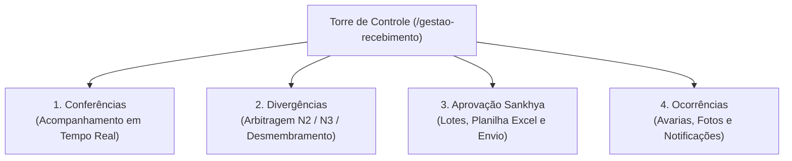
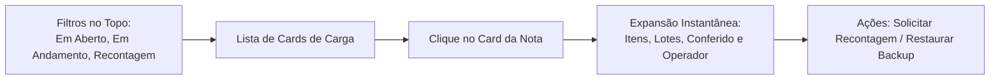
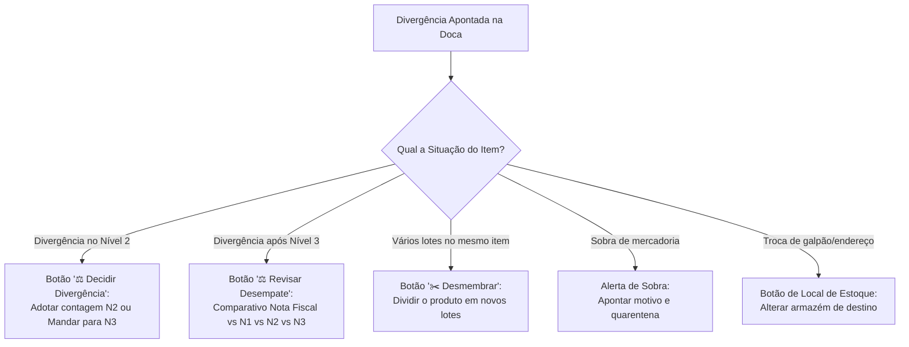
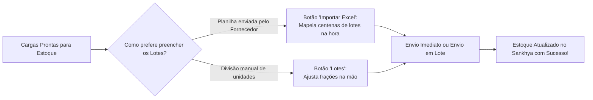
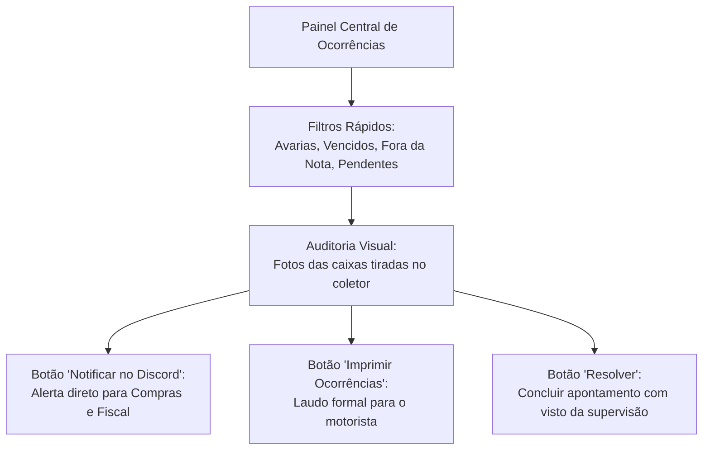

# Guia Prático do Usuário: Gestão de Recebimento & Torre de Controle

> **Público-Alvo:** Gestores de Logística, Supervisores de Almoxarifado, Líderes de Doca e Analistas de Recebimento.  
> **Finalidade:** Manual operacional completo da tela de **Gestão de Recebimento** (`/gestao-recebimento`), fornecendo o domínio total sobre monitoramento em tempo real, resolução de divergências fiscais, arbitragem de desempates, alteração de locais de estoque e envio de mercadorias para o ERP Sankhya.

---

## 1. Visão Geral: A Torre de Controle do Recebimento

A tela de **Gestão de Recebimento** é a estação de trabalho da liderança. Nela, o supervisor não precisa de coletor nem de bipar caixas: seu papel é monitorar o trabalho dos conferentes, desempatar divergências físicas, autorizar alterações de local de armazenagem e integrar as notas fiscais ao estoque do Sankhya.

---

## 2. Aba 1: Painel Geral de Conferências (Monitoramento Operacional)

A primeira aba permite acompanhar a produtividade da equipe e o status de cada carga que está sendo descarregada no armazém.

### 2.1. Filtros Rápidos de Status (Botões Superiores)
No topo da aba, você conta com botões de filtro com contadores em tempo real:
- **Todas:** Panorama geral de todas as conferências ativas e históricas.
- **Em Aberto:** Notas prontas para início que ainda não tiveram nenhum produto bipado.
- **Em Andamento:** Cargas sendo conferidas ativamente nos coletores (Nível 1 ou Nível 2).
- **Recontagem:** Notas com divergência física que estão em contagem de desempate (Nível 3).
- **Concluídas:** Cargas 100% conferidas e liberadas para estoque.
- **Com Backup:** Sessões salvas no histórico com segurança para recuperação de contagem.

### 2.2. Detalhamento dos Itens em Tempo Real
Ao clicar em qualquer card de conferência:
- A linha se expande exibindo a **lista completa de produtos**, com as colunas:
  - **Seq:** Sequência do item na nota.
  - **Código:** Código do produto no sistema.
  - **Produto:** Descrição completa da mercadoria.
  - **Unidade:** Unidade padrão de recebimento (ex: `UN`, `CX`).
  - **Qtd Nota:** Quantidade total faturada pelo fornecedor.
  - **Conferido:** Total de caixas/peças já lidas pelo conferente.
  - **Lote / Validade:** Identificadores apurados no coletor.
- **Etiqueta do Conferente:** Cada card exibe uma badge destacada com o nome do operador que está com o coletor em mãos (ex: `Operador: JOAO.SILVA`), facilitando a comunicação imediata com a doca.
- **Horários:** Visualize o horário exato em que o descarregamento começou e o tempo decorrido.

### 2.3. Restauração de Backups de Conferência
Se um coletor móvel descarregar a bateria, reiniciar ou perder o sinal Wi-Fi no pátio:
1. Localize a carga no painel e clique no botão **`Restaurar Backup`**.
2. O sistema recupera a última contagem gravada no servidor, permitindo que o operador retome o trabalho exatamente de onde parou sem precisar recontar todo o caminhão.

---

## 3. Aba 2: Gestão de Divergências e Arbitragem Fiscal

Esta é a ferramenta de controle da liderança. Quando a contagem física do caminhão não bate com a Nota Fiscal de compra, a carga é listada nesta aba para resolução.

---

### 3.1. Decisão de Divergência em Nível 2 (`ModalDecidirDivergenciaN2`)
Quando o conferente de Nível 2 finaliza a contagem e o sistema encontra divergência de quantidade, lote ou validade em relação à nota:
1. Na linha do produto divergente, clique no botão **`⚖️ Decidir Divergência`**.
2. A janela comparativa exibirá os dados da **Nota Fiscal** ao lado do que o operador apurou na **Conferência N2**.
3. Escolha uma das duas opções:
   - **`✓ Adotar Conferência N2`:** Você confirma que o que o operador contou é o que realmente veio. O sistema acata a contagem e marca o item com o símbolo verde de aprovação (`✓`).
   - **`🔍 Enviar para Reconferência N3`:** Se o valor do item for alto ou houver dúvida, você despacha o item para uma contagem cega de desempate no coletor N3.

---

### 3.2. Revisão de Desempate de Nível 3 (`ModalRevisarDesempate`)
Se a carga passou pela recontagem de Nível 3:
1. Clique no botão **`⚖️ Revisar Desempate`**.
2. O sistema abre uma mesa comparativa com as seguintes colunas:
   - **Nota Fiscal:** Quantidade, Lote, Validade e Fabricação faturadas.
   - **Nível 1:** Contagem física cega inicial.
   - **Nível 2:** Contagem com lote e validade apurada no coletor.
   - **Nível 3:** Recontagem cega de desempate.
3. **Decisão por Bloco:** Ao clicar no nível escolhido (ex: selecionar a coluna **N3**), o sistema adota integralmente a quantidade, o lote e a validade apurados naquele nível.

---

### 3.3. Desmembramento de Itens com Vários Lotes (`ModalDesmembrarItem`)
Quando o fornecedor faturou um produto em uma única linha na nota, mas enviou fisicamente **dois ou mais lotes diferentes** (ex: 60 unidades do Lote A e 40 unidades do Lote B):
- O sistema destaca o botão piscante **`✂️ Desmembrar`**.
- Ao clicar nele, a janela apresenta como a quantidade será dividida para cada lote.
- Você confere as quantidades e clica em **Confirmar Desmembramento**. O sistema cria as novas linhas do produto na nota automaticamente, permitindo que cada lote entre no estoque com sua validade correta.

---

### 3.4. Alteração do Local de Estoque do Produto
Se a mercadoria precisar ser direcionada para um endereço ou galpão diferente do padrão da nota:
1. Na coluna **Local** do produto, clique no botão do **Local de Estoque**.
2. A tela abre a lista de locais de armazenagem cadastrados no sistema (ex: *Almoxarifado Central*, *Área de Quarentena*, *Câmara Fria*).
3. Selecione o novo local. O sistema salva o novo endereço do produto na hora.

---

### 3.5. Tratamento de Sobras de Mercadoria (`ModalOcorrenciaSobra`)
Se chegaram mais caixas físicas do que o faturado na nota:
1. Clique no botão de alerta de **Sobra**.
2. Selecione o motivo (ex: *Brinde comercial*, *Erro de expedição da fábrica*).
3. Defina para qual local de estoque a mercadoria excedente será transferida temporariamente.
4. O sistema registra a ocorrência formalmente para que o setor de Compras negocie com o fornecedor.

---

## 4. Aba 3: Aprovação e Envio ao Estoque Sankhya

Reúne todas as conferências que já estão 100% conferidas e com divergências resolvidas, prontas para serem escrituradas no estoque.

---

### 4.1. Importação de Lotes via Planilha Excel (`ModalImportarLotesExcel`)
Para notas de fornecedores que contêm centenas de lotes fracionados em planilhas:
1. No cabeçalho da conferência, clique no botão **`📥 Importar Excel`**.
2. Arraste ou selecione a planilha (`.xlsx` ou `.xls`).
3. O sistema reconhece automaticamente as colunas da planilha: **Código do Produto**, **Lote**, **Validade** e **Fabricação**.
4. Clique em **Aplicar Importação**. Todos os itens da nota têm seus lotes e validades preenchidos em segundos.
5. Os itens alimentados pela planilha ganham uma etiqueta visual verde **`Origem: Excel`** para auditoria.

---

### 4.2. Gerenciamento e Ajuste Manual de Lotes (`ModalGerenciarLotes`)
Se você precisar dividir as caixas de um produto entre dois lotes manualmente:
1. Na linha do item, clique no botão **`🏷️ Lotes`**.
2. Adicione as divisões informando o lote, a quantidade de caixas e as datas de validade.
3. O sistema avisa em tempo real se a soma das quantidades bate exatamente com o total conferido.

---

### 4.3. Disparo do Envio ao Sankhya
- **Envio Individual da Nota:** No card da carga, clique no botão verde **`🚀 Enviar ao Sankhya`**. Uma janela exibe o resumo fiscal dos itens. Ao confirmar, o sistema grava a entrada no estoque.
- **Envio de Várias Notas em Lote:** Marque as caixinhas de seleção ao lado das conferências que deseja aprovar e clique no botão superior **`📦 Enviar {X} Notas Selecionadas`**. Todas são enviadas em sequência.

---

## 5. Aba 4: Gestão Centralizada de Ocorrências e Alertas

Um painel completo que reúne todas as avarias, produtos vencidos, faltas e sobras apontadas pelos conferentes na doca.

---

### 5.1. Filtros Rápidos por Tipo de Problema
Use os botões de atalho (*chips*) no topo da tela:
- **Pendentes:** Casos em aberto aguardando decisão.
- **Avarias:** Caixas amassadas, itens quebrados ou com vazamento.
- **Vencidos:** Produtos barrados por estarem com data de validade expirada ou prazo de validade curto (shelf-life crítico).
- **Fora da Nota:** Itens físicos recebidos no caminhão que não constam no faturamento.

### 5.2. Auditoria Visual com Fotos da Doca
Ao lado de cada ocorrência apontada com celular ou coletor com câmera, você verá a miniatura da foto da carga. Toque sobre ela para ampliar em alta definição e inspecionar a extensão do dano físico sem precisar descer até a doca.

### 5.3. Envio de Notificações via Discord
Para avisar os compradores e o setor fiscal sem precisar redigir e-mails manuais:
1. Marque as ocorrências desejadas na lista.
2. Clique no botão **`📢 Notificar no Discord`**.
3. O sistema envia um comunicado estruturado no canal da equipe com a foto da avaria, número da Nota Fiscal, nome do fornecedor e a descrição do problema.

### 5.4. Impressão de Laudos e Ressalvas
Se você precisar de um documento impresso para que o motorista da transportadora assine comprovando a avaria:
- Selecione as ocorrências e clique em **`🖨️ Imprimir Ocorrências`**. O sistema gera um laudo de não conformidade pronto para assinatura.

---

## 6. Guia Rápido de Dúvidas do Gestor

### ❓ P1: "Quando devo escolher 'Adotar N2' e quando devo escolher 'Mandar para N3'?"
> **Resposta:** Escolha **Adotar N2** quando o problema for simples (ex: pequeno ajuste de digitação ou diferença mínima de contagem que o conferente sênior confirmou). Escolha **Mandar para N3** quando a discordância de caixas for grande, o item tiver alto valor ou quando o Nível 1 e o Nível 2 tiverem contado números muito diferentes.

### ❓ P2: "O botão de Enviar ao Sankhya está travado com aviso de status pendente"
> **Resposta:** Verifique a Aba de Divergências. Se a carga tiver qualquer produto aguardando desmembramento de lotes (`✂️ Desmembrar`) ou aguardando decisão de desempate, o sistema bloqueia o envio para proteger a integridade do estoque. Assim que você resolver a pendência na tabela, o botão de envio será liberado.

### ❓ P3: "Como mudar o armazém ou galpão de destino de um produto antes de fechar?"
> **Resposta:** Na linha do produto na Aba de Divergências ou Envio, clique no botão da coluna **Local de Estoque**. Escolha o novo armazém na lista e confirme. O sistema altera o destino do item no Sankhya na mesma hora.
