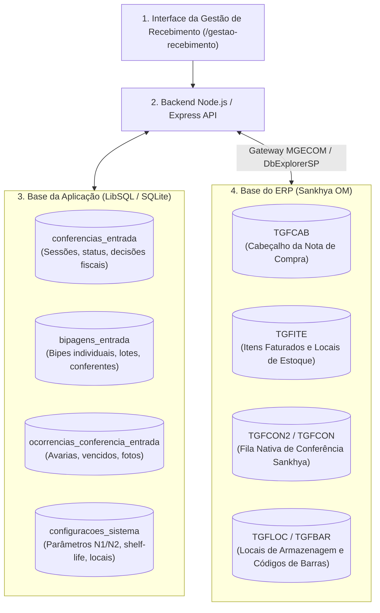

# Matriz Técnica de Suporte & Triagem da IA: Gestão de Recebimento (E2E)

> **Módulo:** Gestão de Recebimento & Torre de Controle (`/gestao-recebimento`)  
> **Bases de Dados Integradas:**  
> 1. **Base da Aplicação (Interna):** LibSQL / SQLite (`conferencias_entrada`, `bipagens_entrada`, `ocorrencias_conferencia_entrada`, `configuracoes_sistema`, `logs_auditoria`)  
> 2. **Base do ERP (Sankhya):** Oracle / SQL Server via Gateway MGECOM (`TGFCAB`, `TGFITE`, `TGFCON2`, `TGFCON`, `TGFLOC`, `TGFBAR`)  
> **Metodologia:** Rastreabilidade Ponta a Ponta (*End-to-End - E2E*): da interação na interface até a persistência nas duas bases.  
> **Público:** Agentes Autônomos de IA (N1) e Analistas de Suporte Técnico N2/TI.

---

## 1. Arquitetura E2E de Duplo Banco de Dados

A aplicação opera com uma arquitetura resiliente de **duas camadas de persistência**:



---

## 2. Matriz E2E de Incidentes Técnicos da Gestão

Abaixo estão mapeados os incidentes mais complexos que ocorrem na supervisão de recebimento, detalhando o comportamento em **ambos os bancos**:

---

### Incidente E2E #01: Falha no Desmembramento de Item da Nota Fiscal

| Camada E2E | Detalhamento Técnico do Fluxo |
| :--- | :--- |
| **1. UX / Gestão** | O gestor clica em **`✂️ Desmembrar`** na Aba de Divergências, preenche as quantidades de cada lote no `ModalDesmembrarItem.tsx` e clica em **"Confirmar"**. A tela trava e exibe: *"Erro ao desmembrar item na TGFITE: Sequência já existente ou nota em uso"*. |
| **2. API / Transporte** | `POST /api/recebimento/conferencia/:id/desmembrar-item`<br>**Payload:** `{ nunota: 1349528, sequencia: 1, lotes: [{ lote: "L1", qtd: 50, dtval: "15/10/2026" }, { lote: "L2", qtd: 30, dtval: "20/12/2026" }] }` |
| **3. Use Case** | `ExecutarDesmembramentoItemUseCase.ts` calcula a nova sequência ($\text{MAX}(\text{SEQUENCIA}) + 1$) e tenta clonar a linha original na `TGFITE` mantendo tributação e rateio contábil. Lança `HTTP 400/500`. |
| **4. Gateway Sankhya** | Disparo de serviço nativo `DatasetSP.saveRecord` ou `DbExplorerSP`. O Sankhya rejeita caso a nota esteja em edição exclusiva ou se a soma dos lotes divergir de `QTDNEG`. |
| **5. Estado nas Bases** | **Base da Aplicação:** `conferencias_entrada.decisoes_fiscais_json` registra intenção pendente de desmembramento.<br>**Base Sankhya:** `TGFITE` possui apenas a linha original. Se a trigger `TRG_INC_TGFITE` abortar, a nova sequência não é persistida. |
| **6. Protocolo IA (N1)** | **Diagnóstico da IA:** Verificar se a soma dos lotes informados bate exatamente com a quantidade faturada e se a nota está aberta em outro terminal.<br>**Ação:** Coleta o `NUNOTA`, `SEQUENCIA` e os lotes e aciona N2 se o lock persistir. |
| **7. Resolução N2 / TI** | Executar o Playbook SQL de Desmembramento (Seção 6.1 e 6.2) para destravar a nota e confirmar a sequência máxima na `TGFITE`. |

---

### Incidente E2E #02: Bloqueio no Envio em Lote ao Sankhya

| Camada E2E | Detalhamento Técnico do Fluxo |
| :--- | :--- |
| **1. UX / Gestão** | Na Aba de Aprovação (`AbaEnvioSankhyaView`), o gestor seleciona 5 notas e clica em **`📦 Enviar 5 Notas Selecionadas`**. O lote é abortado com erro: *"A nota fiscal #Y está com status X e ainda não foi aprovada para envio"*. |
| **2. API / Transporte** | `POST /api/recebimento/conferencia/:id/enviar-sankhya`<br>**Payload:** `{ nunotas: [101, 102, 103, 104, 105], usuario: "GESTOR" }` |
| **3. Use Case** | `EnviarConferenciaSankhyaUseCase.ts` (linhas 59–66) executa a validação atômica. Se uma única nota estiver com status diferente de `Conferido` ou `Divergente` (aprovado), rejeita o lote inteiro por segurança. |
| **4. Gateway Sankhya** | O gateway interrompe a execução para não causar integração parcial descontrolada na fila `TGFCON2`. |
| **5. Estado nas Bases** | **Base da Aplicação:** Na tabela `conferencias_entrada`, o campo `status_por_nota_json` aponta que a nota #Y ainda está em `N2 em Andamento` ou `Aguardando N3`.<br>**Base Sankhya:** `TGFCAB.STATUSCONFERENCIA` da nota #Y permanece inalterado. |
| **6. Protocolo IA (N1)** | **Orientação da IA:** *"O envio em lote foi pausado porque a Nota #Y ainda possui pendências de conferência física ou desempate. Desmarque a Nota #Y da seleção para enviar as outras 4 notas imediatamente e depois resolva a Nota #Y."* |
| **7. Resolução N2 / TI** | Auto-resolução guiada pela IA (sem necessidade de intervenção direta no banco). |

---

### Incidente E2E #03: Erro ao Alterar Local de Estoque no Sankhya

| Camada E2E | Detalhamento Técnico do Fluxo |
| :--- | :--- |
| **1. UX / Gestão** | O supervisor clica no botão de Local de Estoque na linha do produto, seleciona o armazém `105` e clica em Confirmar. A tela retorna alerta: *"Erro ao alterar local no Sankhya: Local inativo ou incompatível com a filial"*. |
| **2. API / Transporte** | `PUT /api/recebimento/conferencia/item/local`<br>**Payload:** `{ nunota: 1349528, sequencia: 2, codlocal: 105, conferenciaId: "uuid" }` |
| **3. Use Case** | `AlterarLocalItemNotaUseCase.ts` dispara comando de atualização no Sankhya para o campo `CODLOCALORIG` da `TGFITE`. |
| **4. Gateway Sankhya** | `DbExplorerSP` executa o `UPDATE`. O Sankhya rejeita via trigger se o local não estiver ativo ou não pertencer à empresa da nota fiscal. |
| **5. Estado nas Bases** | **Base da Aplicação:** A alteração não é confirmada em memória nem salva no log.<br>**Base Sankhya:** `TGFLOC.ATIVO = 'N'` ou falta registro na tabela de relacionamento empresa/local. |
| **6. Protocolo IA (N1)** | **Diagnóstico da IA:** A IA valida que o armazém escolhido está inativo ou sem permissão para aquela filial e lista os armazéns válidos. |
| **7. Resolução N2 / TI** | Executar a query na base Sankhya para checar o status do local e sua amarração com a filial (`TGFLOC`). |

---

## 3. Protocolo de Triagem Automática da IA (Ticket Dispatcher)

Quando o incidente na Gestão exigir escalonamento para N2/TI, a IA coleta obrigatoriamente:
1. **`LOGIN_GESTOR`:** Usuário logado na sessão de gestão.
2. **`ABA_ORIGEM`:** `conferencias`, `divergencias`, `aprovacao_sankhya` ou `ocorrencias`.
3. **`NUNOTA` / `NUMNOTA`:** Número Único Sankhya e Número da Nota Fiscal.
4. **`SEQUENCIA` / `CODPROD`:** Linha e código do produto afetado.
5. **`ACAO_EXECUTADA`:** Desmembramento, Envio Sankhya, Decisão N2/N3 ou Troca de Local.
6. **`MENSAGEM_ERRO`:** Cópia literal da mensagem retornada na interface.
7. **`ESTADO_OPERACIONAL`:** Carga ainda no pátio ou já descarregada no armazém.

---

## 4. Matriz de Severidade & SLAs E2E da Gestão

| Severidade | Impacto Operacional | Critério E2E | SLA Alvo |
| :--- | :--- | :--- | :--- |
| **P1 - Crítico** | **Estoque Travado Geral:** Nenhuma conferência finalizada consegue ser enviada ao Sankhya; serviço `DbExplorerSP` fora do ar. | Falha de infraestrutura que impede liberação de notas fiscais de toda a empresa. | **Até 15 minutos** |
| **P2 - Alto** | **Nota Isolada Bloqueada:** Caminhão descarregado aguardando liberação do motorista, mas erro em `desmembrar-item` impede escrituração. | Carga específica retida na doca gerando custo de estadia de veículo. | **Até 1 hora** |
| **P3 - Médio** | **Inconsistência de Cadastro:** Local de estoque inativo ou lote rejeitado que pode aguardar sem travar a doca. | Divergência em item isolado com o restante da carga já resolvido. | **Até 4 horas** |
| **P4 - Baixo** | **Dúvida Operacional / Integração Secundária:** Dúvida de desempate N3, formatação de planilha Excel ou falha no webhook do Discord. | Sem impacto na entrada física de estoque. | **Até 24 horas** |

---

## 5. Templates Padronizados de Despacho de Ticket

### 5.1. Formato Markdown para Suporte Técnico N2 / TI
```markdown
### 🏛️ [TICKET GESTÃO DE RECEBIMENTO] - {SEVERIDADE} - NOTA {NUMNOTA}
- **Data/Hora:** {TIMESTAMP_LOCAL}
- **Gestor Solicitante:** {LOGIN_GESTOR}
- **Aba Afetada:** Gestão de Recebimento (`{ABA_ORIGEM}`)

#### 📋 Dados do Documento Fiscal
- **Nº da Nota:** {NUMNOTA}
- **Nº Único (Sankhya):** {NUNOTA}
- **Fornecedor:** {RAZAO_SOCIAL_FORNECEDOR}
- **Item / Sequência:** Cód `{CODPROD}` | Seq `{SEQUENCIA}`

#### 🔍 Diagnóstico E2E da Falha
- **Ação Executada:** {DESMEMBRAMENTO_OU_ENVIO_OU_LOCAL}
- **Camada da Falha:** {BASE_APLICACAO_LIBSQL / GATEWAY_SANKHYA / BANCO_ERP_SQL}
- **Mensagem Literal:** `{MENSAGEM_ERRO_LITERAL}`
- **Diagnóstico da IA:** {HIPOTESE_TECNICA_CAUSA_RAIZ}
- **Impacto na Doca:** {CAMINHAO_PARADO_OU_CARGA_JA_DESCARREGADA}
```

---

## 6. Playbook SQL Híbrido: Diagnóstico na Base da Aplicação e no ERP Sankhya

O analista N2 deve utilizar este playbook em **ambas as bases de dados** para investigar e reconciliar incidentes:

### 6.1. Diagnóstico na Base da Aplicação (LibSQL / SQLite)

Execute no cliente LibSQL (`turso` ou ferramenta local de SQLite):

```sql
-- 1. Inspecionar o Estado da Conferência e Decisões Fiscais Salvas
SELECT 
    id AS conferencia_id,
    nunotas_json,
    status,
    nivel_atual,
    conferente,
    status_por_nota_json,
    decisoes_fiscais_json,
    itens_recontagem_json,
    criado_em,
    atualizado_em
FROM conferencias_entrada
WHERE nunotas_json LIKE '%:NUNOTA%' OR numnota = :NUMNOTA;

-- 2. Consolidar Contagem Física Real por Produto e Lote (Bipagens Ativas)
SELECT 
    codprod,
    sequencia,
    lote,
    validade,
    fabricacao,
    SUM(qtd_conferida) AS total_fisico_conferido,
    COUNT(id) AS total_bipes,
    conferente
FROM bipagens_entrada
WHERE conferencia_id = :CONFERENCIA_ID AND anulado = 0
GROUP BY codprod, sequencia, lote, validade, fabricacao
ORDER BY sequencia, lote;

-- 3. Inspecionar Ocorrências Registradas para a Carga
SELECT 
    id,
    tipo,
    codprod,
    descrprod,
    quantidade,
    lote,
    validade,
    status,
    criado_por,
    criado_em
FROM ocorrencias_conferencia_entrada
WHERE nunota = :NUNOTA OR numnota = :NUMNOTA
ORDER BY criado_em DESC;

-- 4. Verificar Parâmetros Ativos de Recebimento no Sistema
SELECT chave, valor, descricao, atualizado_em
FROM configuracoes_sistema
WHERE chave LIKE 'recebimento_%' OR chave LIKE 'conferencia_%';
```

---

### 6.2. Diagnóstico na Base do ERP Sankhya (Oracle / SQL Server via `DbExplorerSP`)

Execute no console do Sankhya:

```sql
-- 1. Diagnóstico do Cabeçalho da Nota e Status Fiscal no Sankhya
SELECT NUNOTA, NUMNOTA, CODPARC, DTNEG, STATUSCONFERENCIA, CODEMP, VLRNOTA
FROM TGFCAB
WHERE NUNOTA = :NUNOTA;

-- 2. Inspecionar Linhas Faturadas, Locais de Armazenagem e Lotes na TGFITE
SELECT 
    I.SEQUENCIA,
    I.CODPROD,
    P.DESCRPROD,
    I.QTDNEG AS QTD_FATURADA,
    I.CODVOL,
    I.CODLOCALORIG,
    L.DESCRLOCAL,
    I.CONTROLE AS LOTE_FISCAL,
    I.DTVAL AS VALIDADE_FISCAL
FROM TGFITE I
JOIN TGFPRO P ON P.CODPROD = I.CODPROD
LEFT JOIN TGFLOC L ON L.CODLOCAL = I.CODLOCALORIG
WHERE I.NUNOTA = :NUNOTA
ORDER BY I.SEQUENCIA;

-- 3. Inspecionar a Fila Oficial de Conferência Nativa Sankhya (TGFCON2)
SELECT NUCONF, NUNOTA, STATUS, CODUSU, DHINIC, DHFIM
FROM TGFCON2
WHERE NUNOTA = :NUNOTA;

-- 4. Inspecionar Itens já Gravados na Fila de Conferência Sankhya (TGFCON)
SELECT NUNOTA, SEQUENCIA, CODPROD, QTDCONF, CONTROLE, DTVAL
FROM TGFCON
WHERE NUNOTA = :NUNOTA;

-- 5. Validar se o Local de Estoque está Ativo e Liberado para a Filial
SELECT CODLOCAL, DESCRLOCAL, ATIVO
FROM TGFLOC
WHERE CODLOCAL = :CODLOCAL;
```

---

### 6.3. Query E2E de Reconciliação (Confronto Cruzado Base App vs ERP)

Esta consulta lógica orienta o suporte a cruzar os dados da **Base da Aplicação** contra o **Sankhya**:

$$\textbf{Divergência de Quantidade} = \sum(\text{bipagens\_entrada.qtd\_conferida}) - \text{TGFITE.QTDNEG}$$

* **Se $\text{Resultado} = 0$:** O produto está 100% fisicamente conferido. Se o botão de envio estiver bloqueado, trata-se de flag de status pendente na tabela `conferencias_entrada` da aplicação.
* **Se $\text{Resultado} > 0$:** Sobra física no armazém. O gestor deve registrar ocorrência de sobra ou acionar Compras.
* **Se $\text{Resultado} < 0$:** Falta física no descarregamento. O gestor deve decidir entre acatar a conferência N2/N3 ou cortar a nota no Sankhya via `ConferenciaSP.cortar`.
