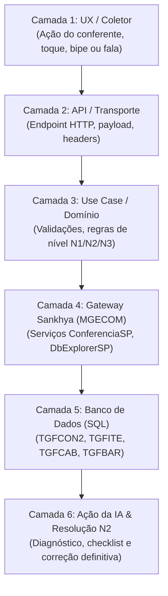
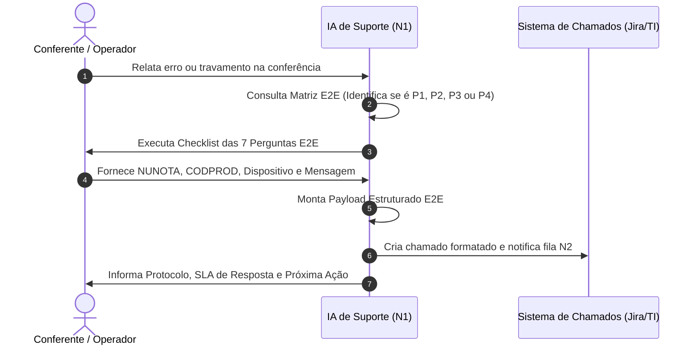

# Matriz de Suporte Técnico & Triagem da IA (Metodologia End-to-End - E2E)

> **Módulo:** Conferência de Entrada & Gestão de Recebimento (Sankhya OM / Evolution)  
> **Metodologia:** Rastreabilidade Ponta a Ponta (*End-to-End - E2E*): da interação física no coletor à escrituração no banco de dados.  
> **Destinatários:** Agentes Autônomos de IA (N1) e Analistas de Suporte Técnico N2/TI.

---

## 1. O Pipeline End-to-End (As 6 Camadas de Rastreamento)

Cada incidente relatado por um operador na doca é mapeado obrigatoriamente através das **6 camadas** da nossa arquitetura:



---

## 2. Matriz E2E de Incidentes, Falhas e Diagnósticos

Abaixo estão mapeados os principais fluxos operacionais de ponta a ponta:

---

### Incidente E2E #01: "Código de Barras Não Encontrado na Nota"

| Camada | Detalhamento Técnico |
| :--- | :--- |
| **1. UX / Coletor** | O conferente bipa uma caixa com o leitor laser (ou digita manualmente). O leitor emite **som de erro grave** (`tocarAlertaErro`) e o input exibe borda vermelha com a mensagem *"Código não encontrado na nota"*. |
| **2. API / Transporte** | `POST /api/recebimento/conferencia/:id/bipar`<br>**Payload:** `{ codigo: "7891234567890", quantidade: 1, nivel: 1 }` |
| **3. Use Case** | `RegistrarBipagemEntradaUseCase.ts` executa a busca interna em memória comparando `codigo` com `itemCorrespondeAoCodigo()`. Retorna `HTTP 400 Bad Request`. |
| **4. Gateway Sankhya** | Dispara serviço de fallback `ConferenciaSP.getProduto` ou `DbExplorerSP` para verificar se o código existe em outras notas do mesmo fornecedor. |
| **5. Banco de Dados** | **Causa Raiz SQL:** O código de barras não consta na tabela `TGFBAR` vinculado ao `CODPROD` daquela nota (`TGFITE`), ou o produto físico é de outro caminhão/fornecedor. |
| **6. Protocolo IA (N1)** | **Pergunta da IA:** *"Você pode confirmar se essa caixa pertence à Nota Fiscal que está no papel ou se veio misturada de outro fornecedor?"*<br>Se for da nota: Coleta `CODPROD` e o código lido, gerando ticket para a TI cadastrar na `TGFBAR`. |
| **7. Resolução N2 / TI** | Inserir o código na tabela de códigos de barras alternativos:  <br>`INSERT INTO TGFBAR (CODPROD, CODBARRA, PADRAO) VALUES (:CODPROD, :CODBARRA, 'N');` |

---

### Incidente E2E #02: Bloqueio de Envio ao Sankhya ("Status Inválido para Integração")

| Camada | Detalhamento Técnico |
| :--- | :--- |
| **1. UX / Coletor** | O gestor clica em **"Enviar ao Sankhya"** na aba de Aprovação (`AbaEnvioSankhyaView`). A tela trava o botão com spinner e exibe banner vermelho: *"A nota fiscal #X está com status Y e ainda não foi conferida/aprovada para envio"*. |
| **2. API / Transporte** | `POST /api/recebimento/conferencia/:id/enviar-sankhya`<br>**Payload:** `{ nunotas: [1349528], usuario: "GESTOR.LOG", nivelEscolhido: 2 }` |
| **3. Use Case** | `EnviarConferenciaSankhyaUseCase.ts` (linhas 59–66) valida se todas as notas do array estão com `status === 'Conferido'` ou `status === 'Divergente'` (com aprovação explícita). Lança `throw new Error(...)`. |
| **4. Gateway Sankhya** | Nenhuma chamada a `ConferenciaSP.finalizarConferencia` é disparada (bloqueio preventivo no Node.js para não corromper o ERP). |
| **5. Banco de Dados** | Na tabela local de sessões ou no Sankhya (`TGFCAB.STATUSCONFERENCIA`), a nota ainda está como `N1 em Andamento`, `N2 em Andamento` ou `Aguardando N3`. |
| **6. Protocolo IA (N1)** | **Diagnóstico da IA:** A IA informa que a nota possui um nível anterior não concluído ou uma divergência pendente de decisão na aba `/gestao-recebimento`. |
| **7. Resolução N2 / TI** | 1. Verificar se há itens com contagem pendente em N1/N2.<br>2. Se a conferência já foi concluída fisicamente, orientar o gestor a clicar em `⚖️ Decidir Divergência` antes de tentar o envio. |

---

### Incidente E2E #03: Disparo Automático de Validade Vencida / Shelf-Life Crítico

| Camada | Detalhamento Técnico |
| :--- | :--- |
| **1. UX / Coletor** | O operador dita por voz *"quinze de outubro de vinte e quatro"* ou digita a validade. Ao sair do campo (`onBlur`), a tela emite som de aviso (`tocarAlertaPedirCampo`) e **o modal de ocorrência abre sozinho** na tela pré-marcado como `VENCIDO` ou `VALIDADE_PROXIMA`. |
| **2. API / Transporte** | Disparado pelo hook local `dateMaskHelper.ts` e confirmado em `POST /api/recebimento/ocorrencias/registrar`. |
| **3. Use Case** | `verificarValidadeEObrirOcorrencia()` aciona `checarStatusValidade(valComp, diasShelfLife = 90)`. Calcula $\Delta = \text{DataValidade} - \text{Hoje}$. Se $\Delta \le 0 \implies \text{VENCIDO}$. Se $0 < \Delta \le 90 \implies \text{VALIDADE\_PROXIMA}$. |
| **4. Gateway Sankhya** | Não bloqueia a rede, mas grava a ocorrência vinculada à sessão de recebimento para auditoria no painel de gestão. |
| **5. Banco de Dados** | Registrado na tabela local/repositório `OcorrenciasRecebimento` com `STATUS = 'PENDENTE'`. |
| **6. Protocolo IA (N1)** | **Orientação da IA:** *"O sistema identificou que a validade deste lote é crítica ou já expirou. Você deve concluir o registro da ocorrência e separar as caixas fisicamente na área de quarentena da doca."* |
| **7. Resolução N2 / TI** | Comprador e fiscal analisam a ocorrência na aba `/gestao-recebimento` e decidem entre emissão de nota de devolução ao fornecedor ou autorização excepcional de shelf-life. |

---

### Incidente E2E #04: Exigência Mandatória de "Desmembramento de Item"

| Camada | Detalhamento Técnico |
| :--- | :--- |
| **1. UX / Coletor** | Na aba de Divergências da Gestão, a linha do produto exibe o botão piscante **`✂️ Desmembrar`** e a nota não permite avanço para o estoque. |
| **2. API / Transporte** | `GET /api/recebimento/conferencia/divergencias` retorna o flag `precisaDesmembrar: true` para a sequência da nota. |
| **3. Use Case** | `ListarDivergenciasEntradaUseCase.ts` identifica que o conferente registrou fisicamente **múltiplos lotes distintos dentro do mesmo nível adotado** (ex: 50 un Lote A e 30 un Lote B) para uma linha fiscal única da `TGFITE`. |
| **4. Gateway Sankhya** | O Sankhya não aceita múltiplos lotes na mesma linha de `TGFITE` sem a criação de uma nova sequência (`SEQUENCIA + 1`). |
| **5. Banco de Dados** | **Estado SQL:** `TGFITE` possui apenas 1 linha com `QTDNEG = 80`. Para integralizar, são necessárias 2 linhas (uma para cada lote). |
| **6. Protocolo IA (N1)** | **Orientação da IA:** *"O fornecedor faturou esses produtos em uma única linha da nota, mas você recebeu dois lotes físicos diferentes. O supervisor deve abrir o modal de desmembramento para o sistema dividir a linha no Sankhya automaticamente."* |
| **7. Resolução N2 / TI** | O supervisor clica em `✂️ Desmembrar`, abre `ModalDesmembrarItem.tsx`, confere as frações e dispara `POST /api/recebimento/conferencia/:id/desmembrar-item`, que executa `ExecutarDesmembramentoItemUseCase.ts` duplicando a linha com segurança no ERP. |

---

### Incidente E2E #05: Tentativa Indevida de Colar Código de Barras (Anti-Fraude)

| Camada | Detalhamento Técnico |
| :--- | :--- |
| **1. UX / Coletor** | O operador copia um número da nota fiscal e aperta `Ctrl+V` ou segura o dedo para "Colar" no campo de código. O texto não entra, a tela dispara som grave de erro e surge o toast: *"Colagem bloqueada: use o leitor de código de barras ou digite os números"*. |
| **2. API / Transporte** | **Bloqueio em borda (Zero Network Overhead):** O evento `onPaste` é interceptado antes de gerar tráfego HTTP. |
| **3. Use Case** | Componente `Campo.tsx` com prop `bloquearColar` executa `e.preventDefault()` e chama `onTentativaColar={handleTentativaColar}` em `ConferenciaEntradaPage.tsx`. |
| **4. Gateway Sankhya** | N/A (proteção de integridade física no cliente). |
| **5. Banco de Dados** | N/A. |
| **6. Protocolo IA (N1)** | **Esclarecimento da IA:** *"Por regra de segurança e auditoria da empresa, o sistema não permite colar códigos da nota fiscal. Cada produto deve ser bipado diretamente da embalagem com o leitor laser ou digitado manualmente tocando no ícone de teclado."* |
| **7. Resolução N2 / TI** | Incidente de usabilidade/procedimento operacional (fechado automaticamente pela IA sem necessidade de ticket). |

---

## 3. Protocolo de Triagem e Despacho de Demandas (IA Ticket Dispatcher)

Quando o incidente não puder ser sanado pelas ações de auto-resolução do operador, a IA executa o roteiro de coleta mandatória:



---

### 3.1. O Checklist E2E de Coleta Obrigatória da IA
A IA **está estritamente proibida** de despachar chamados para o suporte humano sem obter as variáveis abaixo:

1. **`LOGIN_USUARIO`:** Identificador de rede ou usuário logado no sistema.
2. **`ROTA_SISTEMA`:** URL exata (`/recebimento`, `/recebimento/conferencia` ou `/gestao-recebimento`).
3. **`DISPOSITIVO`:** Modelo de coletor (Zebra TC21/TC26, Honeywell, Celular Android ou Desktop).
4. **`NUNOTA` / `NUMNOTA`:** Número Único Sankhya e Número da Nota Fiscal.
5. **`CODPROD` / `CODBARRA`:** Identificador do produto em divergência (se aplicável).
6. **`LOTE` / `VALIDADE`:** Dados informados na bipagem física (se aplicável).
7. **`MENSAGEM_ERRO`:** Cópia literal do texto de erro ou código HTTP retornado.

---

## 4. Matriz de Severidade e SLAs Operacionais

| Severidade | Classificação | Impacto no Armazém | Critérios E2E de Ativação | SLA Alvo |
| :--- | :--- | :--- | :--- | :--- |
| **P1** | **Crítico (Doca Parada)** | Caminhões parados na doca sem conseguir descarregar; tela não registra bipagens; gateway Sankhya offline. | Erros `HTTP 500` recorrentes no backend; queda de rede; banco LibSQL corrompido. | **15 minutos** |
| **P2** | **Alto (Carga Travada)** | Carga 100% descarregada, mas a nota não integra com o estoque do Sankhya ou divergência não abre N3. | Falha no use case `EnviarConferenciaSankhyaUseCase` ou erro em `DbExplorerSP`. | **1 hora** |
| **P3** | **Médio (Item com Pendência)** | Apenas 1 produto da carga está com código de barras desatualizado ou divergência isolada. | Os demais produtos continuam sendo conferidos normalmente. | **4 horas** |
| **P4** | **Baixo (Dúvida / Procedimento)** | Dúvida operacional sobre Modo Coletor, microfone de voz ou sugestão de melhoria. | Resolvido com envio do link do Guia do Usuário pela IA. | **24 horas** |

---

## 5. Templates E2E de Despacho de Ticket

### 5.1. Formato Markdown para Chat Técnico / WhatsApp / Jira
```markdown
### 🚨 [TICKET E2E] - {SEVERIDADE} - RECEBIMENTO SANKHYA
- **Protocolo:** #{TIMESTAMP_HASH}
- **Data/Hora:** {DATA_HORA_LOCAL}
- **Operador:** {LOGIN_USUARIO}
- **Dispositivo:** {DISPOSITIVO_MODELO}
- **Rota Afetada:** `{ROTA_SISTEMA}`

#### 📦 Rastreamento Fiscal & Carga
- **Número da NF:** {NUMNOTA}
- **NUNOTA (Sankhya):** {NUNOTA}
- **Fornecedor:** {RAZAO_SOCIAL_PARCEIRO}
- **Nível Atual:** {N1 / N2 / N3}

#### 🔍 Diagnóstico E2E da Falha
- **Camada Afetada:** {UX / API / USE_CASE / GATEWAY / SQL}
- **Mensagem Literal:** `{MENSAGEM_ERRO_LITERAL}`
- **Produto / Lote:** COD `{CODPROD}` | Lote `{LOTE}` | Val `{VALIDADE}`
- **Causa Provável Identificada pela IA:** {CAUSA_PROVAVEL_E2E}
- **Ação Imediata Executada:** {AUTO_RECOVERY_TENTADO}
```

### 5.2. Formato JSON para Webhook de Integração (API de Chamados)
```json
{
  "ticketE2E": {
    "origem": "ASSISTENTE_IA_CONFERCHECK",
    "timestamp": "2026-10-29T22:06:00-03:00",
    "severidade": "P2",
    "camadaFalha": "GATEWAY_SANKHYA",
    "operador": {
      "login": "ANTONY.B",
      "dispositivo": "Zebra TC26 Android",
      "rota": "/recebimento/conferencia"
    },
    "fiscal": {
      "nunota": 1349528,
      "numnota": 98745,
      "fornecedor": "FORNECEDOR INDUSTRIAL S/A",
      "nivel": 2
    },
    "rastreabilidade": {
      "codprod": 10234,
      "codbarra": "7891000200034",
      "lote": "L2405-B",
      "validade": "15/10/2026"
    },
    "erro": {
      "codigoHttp": 400,
      "mensagemOriginal": "A nota fiscal está com status N2 em Andamento e ainda não foi aprovada",
      "diagnosticoIA": "Tentativa de envio ao ERP com divergência de lote não decidida"
    }
  }
}
```

---

## 6. Playbook SQL Híbrido: Diagnóstico na Base da Aplicação e no ERP Sankhya

Para agilizar o atendimento, os analistas de suporte humano e a IA devem consultar **ambas as bases de dados** para reconciliar o estado físico e fiscal:

### 6.1. Diagnóstico na Base da Aplicação (LibSQL / SQLite)
Execute no cliente LibSQL local (`turso` ou CLI do SQLite):

```sql
-- 1. Inspecionar Sessão de Conferência da Nota
SELECT id, nunotas_json, status, nivel_atual, conferente, criado_em, atualizado_em
FROM conferencias_entrada
WHERE nunotas_json LIKE '%:NUNOTA%' OR numnota = :NUMNOTA;

-- 2. Inspecionar Todas as Bipagens Registradas para o Produto
SELECT 
    id,
    codbarra,
    qtd_conferida,
    nivel,
    lote,
    validade,
    fabricacao,
    conferente,
    timestamp,
    anulado
FROM bipagens_entrada
WHERE nunota = :NUNOTA AND codprod = :CODPROD
ORDER BY timestamp DESC;

-- 3. Inspecionar Ocorrências Registradas para o Item
SELECT id, tipo, quantidade, lote, validade, status, criado_por, criado_em
FROM ocorrencias_conferencia_entrada
WHERE nunota = :NUNOTA AND codprod = :CODPROD;
```

---

### 6.2. Diagnóstico na Base do ERP Sankhya (Oracle / SQL Server via `DbExplorerSP`)
Execute no console do Sankhya:

```sql
-- 1. Diagnóstico do Cabeçalho da Nota e Status Fiscal
SELECT NUNOTA, NUMNOTA, CODPARC, DTNEG, VLRNOTA, STATUSCONFERENCIA
FROM TGFCAB
WHERE NUNOTA = :NUNOTA;

-- 2. Diagnóstico da Fila Oficial de Conferência Sankhya
SELECT NUCONF, NUNOTA, STATUS, CODUSU, DHINIC, DHFIM
FROM TGFCON2
WHERE NUNOTA = :NUNOTA;

-- 3. Comparativo E2E: Faturado na Nota vs Bipado no Coletor
SELECT 
    I.SEQUENCIA,
    I.CODPROD,
    P.DESCRPROD,
    I.QTDNEG AS QTD_FATURADA_ERP,
    C.QTDCONF AS QTD_CONFERIDA_COLETOR,
    C.CONTROLE AS LOTE_APURADO,
    C.DTVAL AS VALIDADE_APURADA
FROM TGFITE I
JOIN TGFPRO P ON P.CODPROD = I.CODPROD
LEFT JOIN TGFCON C ON C.NUNOTA = I.NUNOTA AND C.SEQUENCIA = I.SEQUENCIA
WHERE I.NUNOTA = :NUNOTA
ORDER BY I.SEQUENCIA;

-- 4. Validar se o Código de Barras Existe no Cadastro
SELECT CODPROD, CODBARRA, PADRAO
FROM TGFBAR
WHERE CODBARRA = :CODBARRA;
```
