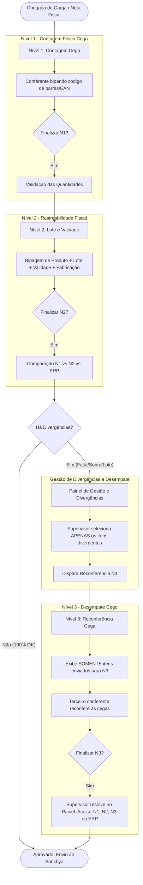

# Especificação Oficial: Sigilo de Conferência de Entrada, Modo Cego e Fluxo N1/N2/N3

> [!CAUTION]
> **REGRA DE BLOQUEIO ARQUITETURAL (IMUTÁVEL):**
> Esta especificação define o comportamento mandatório da **Conferência de Entrada** (Recebimento de Mercadorias).
> **NENHUM AGENTE DE IA OU DESENVOLVEDOR ESTÁ AUTORIZADO A MODIFICAR A LÓGICA DE ABAS, COLUNAS OU EXIBIÇÃO DE CAMPOS SENSÍVEIS SEM APROVAÇÃO EXPLÍCITA DO OPERADOR HUMANO.**

---

## 1. Princípio Fundamental: Sigilo Fiscal e Contagem Cega

A Conferência de Entrada tem como objetivo validar fisicamente as mercadorias recebidas dos fornecedores em relação às Notas Fiscais de Compra emitidas.

Para garantir a idoneidade do processo e evitar que o conferente apenas "confirme" o que está no papel ou pare de contar ao atingir o número esperado:
1. **O conferente operacional NUNCA deve saber a quantidade esperada da nota fiscal.**
2. **O conferente operacional NUNCA deve receber pistas visuais de completude** (como um produto sumir da tela, mudar de aba de pendente para conferido, ou trocar de cor para "verde/concluído").
3. A separação em duas abas (*"Itens Pendentes"* e *"Itens Conferidos"*) é **EXCLUSIVA** para usuários privilegiados (Supervisores/Gestores) em conferências abertas.

---

## 2. Matriz de Permissões e Identificação do Modo Cego

### 2.1. Papéis de Usuário
O controle de privilégios é avaliado pela função `podeVerCamposSensiveis(user?.nomeUsu)` em [`frontend/src/domain/permissions.ts`](../../frontend/src/domain/permissions.ts):
- **Usuários Privilegiados (Supervisores):** `SUP`, `ANTONY`, `ANTONY.B` (veem quantidades esperadas, códigos de barra, referências e status completo).
- **Conferentes Operacionais:** Todos os demais usuários (visão cega mandatória).

### 2.2. Regra Condicional Unificada do Modo Cego
O sistema opera em **Modo Cego / Sigilo** se qualquer uma das condições abaixo for verdadeira:
```typescript
const isModoCego = !verCamposSensiveis || isCega || ocultarStatus;
```
Onde:
- `!verCamposSensiveis`: Usuário logado não possui privilégio de supervisor.
- `isCega`: A conferência possui itens com `qtdneg === null` (ocultação forçada pelo backend).
- `ocultarStatus`: Configuração de tela/parâmetro ativada no Sankhya (`TGFPAR`/`TGFCFG`).

---

## 3. Matriz Visual: Modo Cego vs Modo Privilegiado

| Elemento Visual | Modo Cego / Conferente (`isModoCego === true`) | Modo Privilegiado / Supervisor (`isModoCego === false`) |
| :--- | :--- | :--- |
| **Abas de Produtos** | **Aba Única:** `Produtos da Conferência` (todos os itens juntos) | **Duas Abas:** `Itens Pendentes` e `Itens Conferidos` |
| **Mini Cards (Topo)** | `Total` (itens distintos) e `Bipados` (volume total conferido) | `Total`, `Conf` (itens 100% ok) e `Pend` (itens faltantes) |
| **Coluna Esperado** | **PROIBIDA (Oculta).** Não renderizar `<th>` nem `<td>`. | Exibida com a quantidade fiscal da nota (`qtdneg`). |
| **Coluna Quantidade** | **Apenas UMA coluna:** `Conferido N{nivel}` (contagem física real) | Duas colunas: `Esperado` e `Conferido N{nivel}` |
| **Coluna Status** | **PROIBIDA (Oculta).** Proibido exibir `Parcial`, `Pendente` ou traços `—`. | Exibida com badges coloridas (`Parcial`, `Conferido`, `Sobra`). |
| **Coluna Ações** | Coluna compacta `Ações` contendo apenas botões operacionais (`↺ Bip`, `⚠️ Ocorrência`) | Embutida na coluna de Status ou coluna de ações. |
| **Linhas da Tabela** | Fundo neutro padrão (proibido destacar linha com borda/fundo verde ou parcial) | Destaque visual para itens parcialmente conferidos (`row-parcial`). |
| **Cards Mobile** | Sem badge de status e sem exibição de quantidade esperada | Badges de status visíveis e comparação Esperado vs Conferido. |

---

## 4. Fluxo Completo dos 3 Níveis de Conferência (N1, N2 e N3)

A conferência de recebimento no ConferCheck é estruturada em 3 níveis progressivos para garantir precisão e segregação de funções:



### 4.1. Nível 1 (N1: Contagem Cega Inicial)
* **Objetivo:** Registro estrito da quantidade física de caixas/unidades descarregadas do caminhão.
* **Operação:** O conferente apenas bipa o código de barras e informa a quantidade contada.
* **Visão:** Totalmente cega (`isModoCego === true`). O conferente não sabe a quantidade da NF nem se atingiu o total.

### 4.2. Nível 2 (N2: Lote, Validade e Fabricação)
* **Objetivo:** Garantia de rastreabilidade para produtos controlados por lote e validade sanitária/fiscal.
* **Operação:** O conferente informa ou dita via voz: `Código do Produto` + `Lote` + `Data de Validade` + `Data de Fabricação` + `Quantidade do Lote`.
* **Validação:** Validações de integridade de data (validade posterior à fabricação, ano >= 2000, produto não vencido).
* **Visão:** Mantém o sigilo do Modo Cego. Itens com múltiplos lotes possuem gaveta accordion retrátil para auditoria dos lotes já bipados pelo próprio conferente.

### 4.3. Nível 3 (N3: Reconferência / Desempate)
* **Objetivo:** Desempatar discordâncias entre N1, N2 e a Nota Fiscal emitida pelo fornecedor.
* **Segregação:**
  1. Apenas os itens explicitamente enviados pela Gestão para N3 aparecem na tela do conferente N3.
  2. Notas ou itens que já estavam 100% corretos não são reabertos para o conferente N3.
  3. **Bloqueio de Fila:** Se uma conferência N3 já estiver em andamento, o sistema bloqueia novos envios do mesmo item até que seja finalizada ou cancelada pela Gestão.
  4. O conferente N3 faz a contagem em modo estritamente cego, sem saber quem errou (se foi o N1 ou o N2).

---

## 5. Regras de Transição e Comportamento dos Itens

### 5.1. No Modo Privilegiado (`isModoCego === false`):
* O item inicia na aba **"Itens Pendentes"**.
* Quando `conferido >= esperado`, o item migra automaticamente para a aba **"Itens Conferidos"**.
* Se `conferido > 0` e `conferido < esperado`, o item permanece em Pendentes com badge `Parcial`.
* Se `conferido > esperado`, exibe alerta visual de `Sobra`.

### 5.2. No Modo Cego (`isModoCego === true`):
* **NÃO EXISTE MIGRAÇÃO ENTRE ABAS.** Todos os itens permanecem visíveis na lista única de produtos da nota.
* O valor de `Conferido N{nivel}` apenas incrementa conforme as bipagens ocorrem.
* O sistema **NUNCA** informa se o item foi concluído, se falta produto ou se sobrou.
* Ao concluir a bipagem de toda a carga, o conferente clica em **"Finalizar N{nivel}"** e o sistema valida as divergências internamente no backend.

---

## 6. Checklist de Integridade para Qualquer Modificação de Código

Antes de aprovar qualquer PR ou alteração em [`ConferenciaEntradaPage.tsx`](../../frontend/src/presentation/pages/ConferenciaEntradaPage.tsx):

- [ ] A flag `isModoCego` contempla `!verCamposSensiveis || isCega || ocultarStatus`?
- [ ] A aba única `Produtos da Conferência` é renderizada quando `isModoCego` for `true`?
- [ ] As abas `Itens Pendentes` e `Itens Conferidos` estão bloqueadas para conferentes comuns?
- [ ] A tabela desktop possui apenas UMA coluna de contagem física (`Conferido N{nivel}`) no Modo Cego?
- [ ] As colunas `Esperado` e `Status` estão estritamente ocultas no Modo Cego?
- [ ] Os contadores do cabeçalho mostram apenas `Total` e `Bipados` no Modo Cego (sem `Conf` e `Pend`)?
- [ ] A alteração foi validada com `npm run build` no frontend e no backend?
