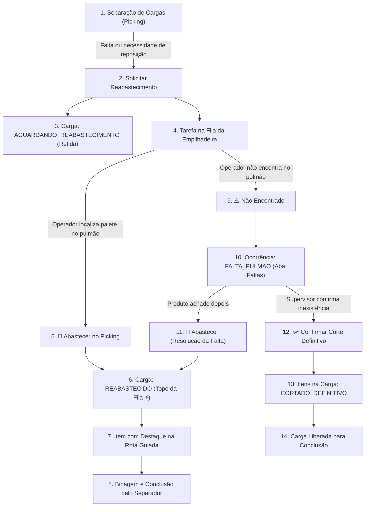

# Especificação Arquitetural e Regras de Negócio: Reabastecimento de Pulmão ⟷ Separação de Cargas

Este documento estabelece as regras mandatórias, os estados de ciclo de vida e os padrões visuais para a integração entre o módulo de **Reabastecimento de Picking (Equipe de Empilhadeira)** e a **Separação de Cargas de Venda (Operadores de Picking)** do ConferCheck.

---

## 📌 1. Visão Geral do Fluxo Integrado

A separação de pedidos depende diretamente do abastecimento físico das posições de picking a partir das posições de pulmão (estoque vertical ou aéreo). Quando um item no picking entra em falta física ou precisa de reposição, o sistema vincula a **Separação da Carga** à **Fila da Empilhadeira**.

---

## 🔄 2. Estados e Ciclo de Vida das Tarefas de Reabastecimento

As tarefas da tabela `tarefas_reabastecimento` possuem o seguinte ciclo de status:

| Status | Significado Operacional | Ações Disponíveis |
|---|---|---|
| `PENDENTE` | Produto com endereço de pulmão identificado aguardando movimentação | `[ 🚜 Abastecer ]`, `[ ⚠️ Não Encontrado ]`, `[ ✕ Recusar ]` |
| `VERIFICAR_ESTOQUE` | Produto sem pulmão cadastrado (verificar estoque geral na empresa) | `[ 🚜 Abastecer ]`, `[ ⚠️ Não Encontrado ]`, `[ ✕ Recusar ]` |
| `FALTA_PULMAO` | Empilhadeirista apontou que o produto não foi encontrado fisicamente | `[ 🚜 Abastecer ]` (se achou depois) ou `[ ✂️ Confirmar Corte Definitivo ]` |
| `FALTA_CONFIRMADA` | Ocorrência de falta encerrada com autorização de corte no pedido | Nenhuma (histórico arquivado) |
| `CONCLUIDO` | Mercadoria transferida e quantidade confirmada no picking | Nenhuma (registra atendido por e data) |
| `CANCELADO` | Tarefa cancelada/recusada com justificativa operacional | Nenhuma (registra motivo) |

---

## 🔒 3. Permissões de Acesso por Usuário (`ModulosUsuario`)

O acesso às telas e ações é protegido em duas camadas (Frontend + BFF):

1. **`reabastecimento`**: Permite ao usuário visualizar a fila de reabastecimento de picking e consultar estoques disponíveis.
2. **`reabastecimento_confirmar`**: Permite acionar o botão `[ 🚜 Abastecer ]`, confirmando a baixa física e informando a quantidade real colocada no picking.
3. **`reabastecimento_cancelar`**: Permite acionar `[ ✕ Recusar ]`, recusando a tarefa com justificativa.
4. **`reabastecimento_finalizar_falta`**: Exclusivo para supervisores/gestores. Permite acessar tarefas em `FALTA_PULMAO` e confirmar o encerramento com corte definitivo no pedido (`[ ✂️ Confirmar Corte Definitivo ]`).

---

## 🎨 4. Padrões Visuais e de Interface (Card Minimalista)

O card de reabastecimento (`ReabastecimentoPage.tsx`) segue padrões estritos de economia de espaço:

1. **Cabeçalho:**
   - Origem à esquerda (`Carga #41205`, `🏢 Empresa`, badges de status `Falta de Pulmão`).
   - Quantidade à direita em badge arredondado suave (`1 UN a Abastecer` ou `✓ Abastecido`).
2. **Identificação do Produto:**
   - Código e descrição em destaque (`CODPROD - DESCRPROD`).
   - Referência e códigos de barra em linha secundária cinza sutil.
3. **Rota Simétrica em 2 Colunas (Rótulo + Endereço):**
   - **Origem (Pulmão):** Rótulo `📦 Pulmão` na linha superior (cinza discreto `11px`); endereço real em negrito escuro ou `Sem endereço` em vermelho suave na linha inferior.
   - **Seta Central:** `➔` separando origem e destino.
   - **Destino (Picking):** Rótulo `📍 Picking` na linha superior (cinza discreto `11px`); endereço real em negrito escuro ou `Sem endereço` em vermelho suave na linha inferior.
4. **Saldo Estoque com Popover Escuro Flutuante:**
   - Exibição de `📦 Saldo Estoque: X UN` com badge interativo `locais (N) ▾`.
   - Ao passar o mouse (desktop) ou clicar (mobile/touch), abre um popover escuro flutuante sobreposto (`z-index: 250`) detalhando cada local, lote e saldo disponível, sem empurrar os elementos do card verticalmente.
5. **Botão Informativo Flutuante `[ ℹ️ ]`:**
   - As observações não utilizam caixas estáticas amarelas fixas.
   - Um botão circular minimalista `[ ℹ️ ]` fica posicionado ao lado dos metadados da solicitação.
   - **No Desktop:** hover abre popover/tooltip flutuante com sombra suave e seta direcional.
   - **No Mobile (Touch / Coletor):** clique/toque abre e fecha o balão flutuante sem quebrar o layout.
6. **Ações no Rodapé:**
   - Para tarefas em `FALTA_PULMAO`: exibe `[ 🚜 Abastecer ]` e `[ ✂️ Confirmar Corte Definitivo ]` lado a lado.
   - Para tarefas pendentes: exibe `[ ✕ Recusar ]`, `[ ⚠️ Não Encontrado ]` e `[ 🚜 Abastecer ]`.

---

## 🚚 5. Regras de Integração com a Separação de Cargas

1. **Bloqueio de Conclusão Prematura:**
   - Uma carga vinculada a tarefas ativas de reabastecimento assume o status `AGUARDANDO_REABASTECIMENTO` com badge `⏳ Aguardando Reabastecimento`.
   - O modal de conclusão da carga oferece a opção `🚜 Solicitar Reabastecimento e Aguardar`, impedindo o fechamento antes da atuação da empilhadeira.
2. **Priorização de Cargas Reabastecidas:**
   - Ao concluir a última tarefa pendente de uma carga, o status da separação muda para `REABASTECIDO`.
   - Cargas reabastecidas recebem badge `⚡ Pick Reabastecido` e **ocupam o topo absoluto da lista de cargas pendentes**, garantindo que o operador finalize o pedido imediatamente.
   - Na **Rota Guiada**, o produto recém-abastecido é posicionado como primeiro item a ser bipado com badge `⚡ Pick Reabastecido`.
3. **Resolução por Corte Definitivo:**
   - Se a falta for confirmada pelo gestor (`FALTA_CONFIRMADA`), os itens correspondentes na separação recebem `statusItem = 'CORTADO_DEFINITIVO'`, desbloqueando a carga para finalização normal pelo separador.
